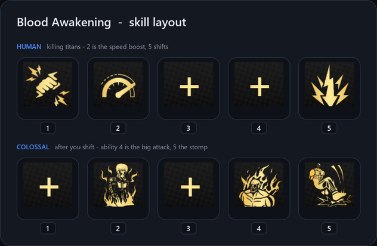
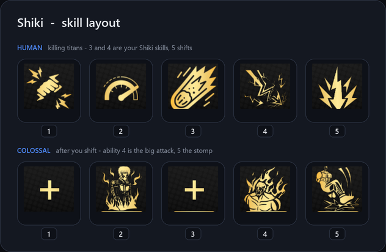
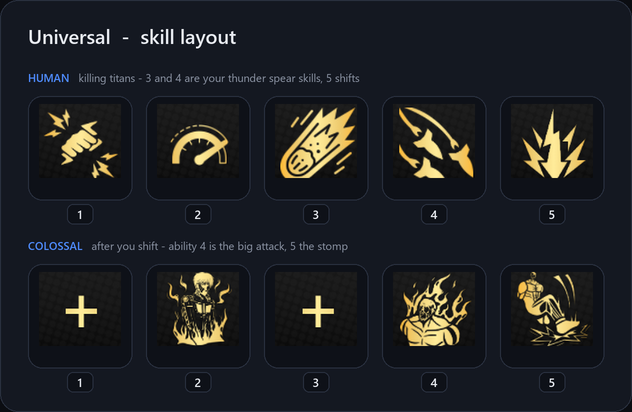
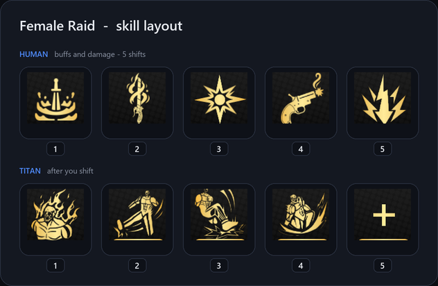

# Colossal Macro - v1.0 (beta)

Grind macro for **Attack on Titan Revolution** (Roblox), built for Colossal users. Windows app (one `.exe`, nothing to install).

**Download:** the exe is on the [Releases](../../releases) page. How to use it: [HOW TO USE.txt](HOW%20TO%20USE.txt) (also inside the app: Guide).

## What it does
- Routines: Blood Awakening (Colossal), Shiki, Universal (thunder spears), Female Raid.
- Smart waits: sees when you're shifted and when the shifted ability 4 has gone off, instead of fixed waits.
- Speed finder: tests shorter dash / strafe times and keeps only what is really faster.
- Reads the result and loot on every end screen; stats, run history, per-step times and an analytics page.
- Discord webhook / bot (messages, stats graph, remote commands), auto-reconnect, session limits.
- Works fullscreen or windowed; themes and accent colour.

## Builds and skill layouts
Put your skills on these keys (or change the keys in the app: Settings > Keybinds). Each picture shows the human bar (killing titans) and the bar once you've shifted. For every routine avoid the perks **Adaptation**, **Tatsujin** and **Wings of Freedom**, and the **Flashsteps** memory.

### Blood Awakening

- **Family:** any (Shiki for luck, Fritz for extra gems)
- **Perks:** Warchief or Stormwrath, Immortal, Founder's Blessing or Avatar of Ymir, Munition Masters
- **Artifacts:** Colossal Scars and Cloak, both with Shifter Dmg%
- **Memories:** Blood Awakening (required); optional: any legendary memory or memories that add damage

### Shiki

- **Family:** Shiki - skill tree right, right, left
- **Perks:** Kengo or Godforged, Immortal, Founder's Blessing or Avatar of Ymir, Munition Masters - you need **Godforged or Avatar of Ymir**
- **Artifacts:** Colossal Scars and Cloak, both with TS Dmg%
- **Memories:** **Apotheosis** and **Afterimages** (both required); optional: any legendary memory or memories that add damage

### Universal (thunder spears)

- **Family:** Fritz, or Reiss, or any other - skill tree right, right, left (don't unlock the skill tree for the Fritz family)
- **Perks:** Kengo or Godforged, Immortal, Founder's Blessing or Avatar of Ymir, Munition Masters - you need **Godforged or Avatar of Ymir**
- **Artifacts:** Colossal Scars and Cloak, both with TS Dmg%
- **Memories:** **Apotheosis** and **Afterimages** (both required); optional: any legendary memory or memories that add damage

### Female Raid

- **Family:** Fritz - skill tree right, right, left; capstone, capstone, no capstone
- **Perks (all required):** Stormwrath, Avatar of Ymir, 15th Commander, Immortal, Font of Inspiration - don't take Adaptation (the failsafe needs it off)
- **Artifacts:** Colossal Scars and Scorched Cloak, both with Shifter Dmg%
- **Memories (all required):** Blood Awakening, Divine Decree, Sparks of Black, Shatterpoint, Elementalist or Tactician

## Build it yourself
Needs Python 3 on Windows:

```
python -m pip install pyinstaller opencv-python numpy pillow
build.bat
```

The exe ends up in `dist\`.

## Note
The macro only presses keys and clicks; it doesn't touch game files. Macros may still be against a game's rules - use it at your own risk.
